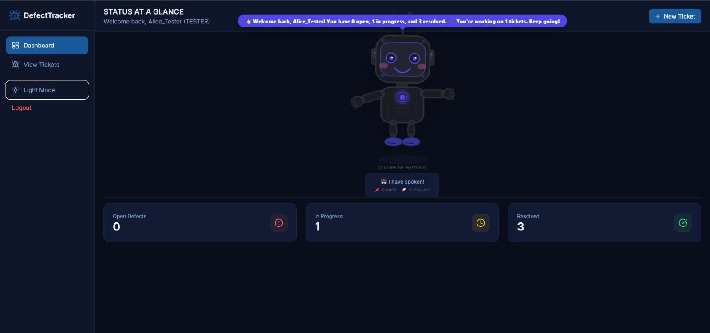
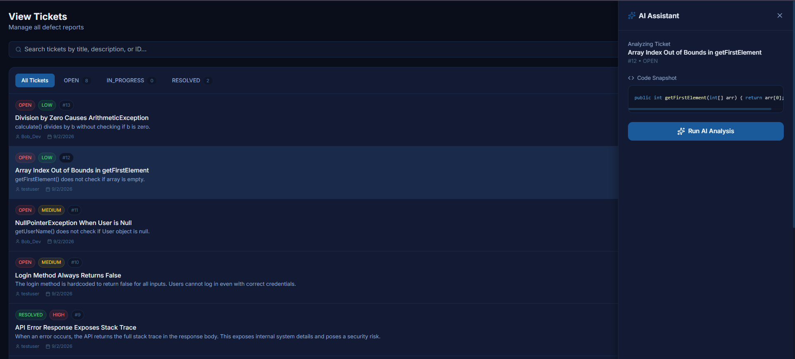
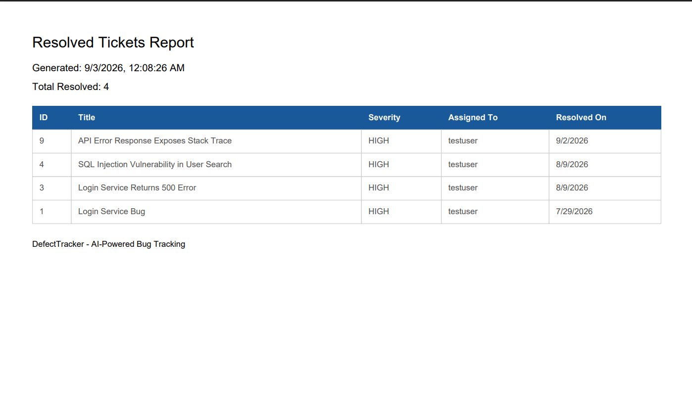
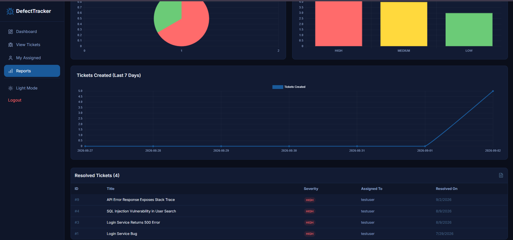
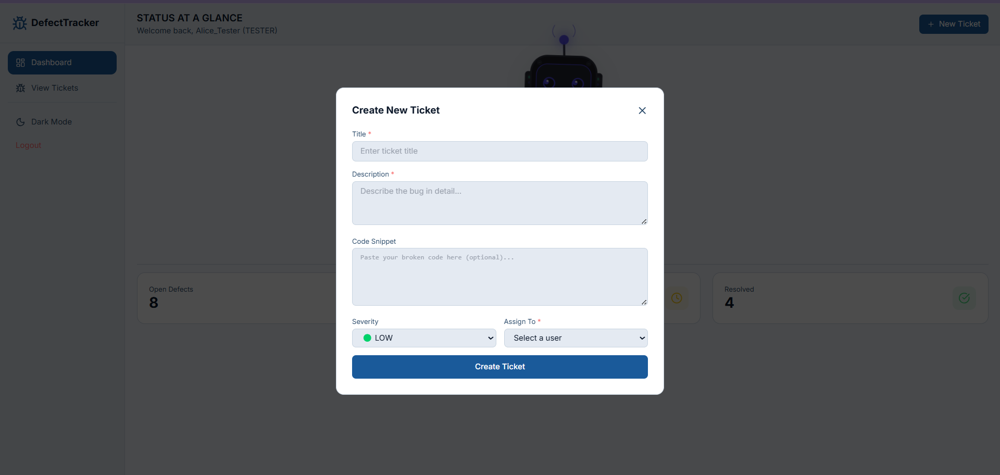
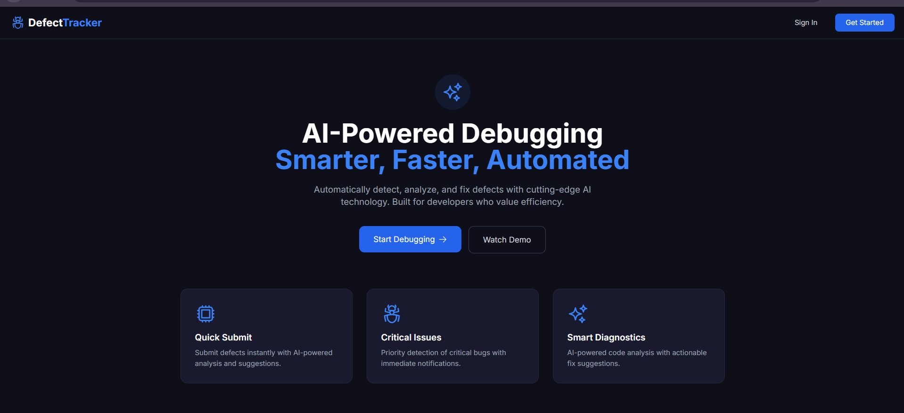

# 🐞 Intelligent Defect Tracker with AI Code Assistant

A full-stack, JIRA-style defect tracking application that leverages **Google Gemini AI** to analyze bugs and suggest code fixes automatically.

## 🚀 Features
- **Role-Based Access Control:** Separate dashboards and permissions for Testers and Developers.
- **AI-Powered Code Analysis:** Automatically analyzes broken code snippets and provides fix suggestions using the Gemini API.
- **Ticket Management:** Create, assign, filter, search, and soft-delete tickets.
- **Analytics Dashboard:** Visual reports using Chart.js and PDF export capabilities.
- **Secure Authentication:** Session-based authentication.
- **Modern UI:** Responsive design with Dark/Light mode and an interactive AI assistant panel.

## 🛠️ Tech Stack
- **Frontend:** React.js, Tailwind CSS, Chart.js, jsPDF
- **Backend:** Java, Spring Boot, Spring Data JPA, HttpSession
- **Database:** MySQL
- **AI Integration:** Google Gemini API
- **Tools:** Maven, Postman, Git

## 🏗️ System Architecture
1. Testers create tickets and assign them to Developers.
2. Developers open the ticket and click "Run AI Analysis".
3. The backend calls the Gemini API with the code snippet.
4. The AI returns a detailed explanation and a code fix, which is displayed in the UI.

## ⚙️ How to Run Locally

### 1. Database Setup (MySQL)
Create a database named `defect_tracker_db` and run the provided SQL scripts to create the `users` and `tickets` tables.

### 2. Backend Setup (Spring Boot)
1. Open the `defect_tracker` folder in IntelliJ IDEA or Eclipse.
2. Update `src/main/resources/application.properties` with your MySQL credentials and Gemini API key.
3. Run `mvn spring-boot:run`. The backend will start on `http://localhost:8080`.

### 3. Frontend Setup (React)
1. Open terminal and navigate to the `defect-tracker-ui` folder.
2. Run `npm install` to install dependencies.
3. Run `npm start`. The frontend will open on `http://localhost:3000`.

## 🔐 Demo Credentials
- **Tester:** `Alice_Tester` / `password123`
- **Developer:** `testuser` / `password123`

## 📸 Screenshots

### Dashboard

### AI Analysis

### Reports & Analytics

### Create Ticket

### Home Page

### Login Page

